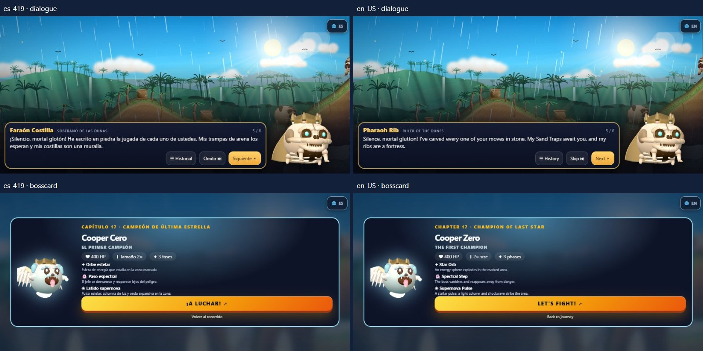

# QA de localización bilingüe

Validación local del 17 de octubre de 2026. Base publicada: `0f8cc74`. Rama `feature/coopers-siege-i18n-es419-en`. No se modificó main ni se desplegó la actualización.

## Contenido y cobertura

1620 claves por idioma; 119 recursos originales corregidos en español; 1520 valores ingleses diferentes y 100 términos compartidos. Cobertura por módulo y arquitectura: [LOCALIZACION.md](LOCALIZACION.md). Nomenclatura definitiva de personajes, armas, mapas, habilidades, música, rarezas y cosméticos: [GLOSARIO.md](GLOSARIO.md).

17 capítulos, 106 escenas, 319 intervenciones; créditos y frases de fase incluidos. Se preservan IDs, orden, hablantes y expresiones de 5.2. El cambio con 🌐 ES / EN conserva combate y diálogo, y se guarda como preferencia independiente.

## Pruebas ejecutadas

`node tests/run-all.cjs` (entry point de npm test), 20/20:

- ✔ LAN 6v6 (original) (11 s)
- ✔ LAN 5.1: controles nuevos y mapa 17 (7 s)
- ✔ Escenarios ampliados (13 s)
- ✔ Daño, gore y destrucción (5 s)
- ✔ HUD responsivo (6 s)
- ✔ Controles 5.1 (táctil y teclado) (8 s)
- ✔ Arsenal 5.2 e igualdad humano/bot (7 s)
- ✔ Huesitos 5.2 (suministros, IA y LAN) (16 s)
- ✔ Campaña 5.2 (34 estados, jefes, guardado, final) (20 s)
- ✔ Física 2× de jefes en 17 mapas (15 s)
- ✔ IA campaña: trayectorias, rutas y equidad (16 s)
- ✔ Auditoría campaña: historial, guardado y escopeta (3 s)
- ✔ Narrativa y diálogo 5.2 (8 s)
- ✔ Banda sonora y efectos (8 s)
- ✔ Mezcla de audio 5.1 (32 s)
- ✔ Servicio de idiomas (0 s)
- ✔ Catálogos y estructura bilingüe (0 s)
- ✔ Cambio en vivo y guardados bilingües (8 s)
- ✔ LAN con idiomas distintos (6 s)
- ✔ Guardados 5.2 y progresión bilingüe (19 s)

Repetidas tras los ajustes finales: entrada específica `node tests/i18n.cjs`, HUD y controles originales. Sin claves ausentes, marcadores ni errores de JavaScript en los recorridos ejecutados.

Guardados: 70 importaciones cubren los 35 estados (0–34) en ambos sentidos; 68 victorias verifican las 34 batallas por idioma. Guardado generado por el código real de 5.2, exportación/importación, historial, fases antes/después de jefe y preferencia tras cerrar/reabrir Chromium aprobados. Son pruebas programáticas de resultados/transiciones, no 68 partidas humanas. LAN real entre páginas: anfitrión/invitado en idiomas opuestos, cambio durante coop 6v6, propiedad y canje único, vida, munición y terreno sincronizados.

## Revisión visual

**264 combinaciones aprobadas**: 22 pantallas × dos idiomas × seis perfiles. PC 1366×768, S23 915×412, plegable 904×832, tableta 1180×820, compacto 640×360 y vertical 412×915. Comprobaciones geométricas y revisión de hojas comparativas/capturas representativas. No hay solapes del selector con controles visibles ni diálogos fuera de pantalla en estos casos. Se reservó espacio en cabeceras, modales y menú vertical; los mapas permiten nombres completos en varias líneas. No se redujo globalmente la fuente.

Incluye menú, selector, mapas, preparación, combate, arsenal, huesitos, recorrido, diálogo, jefe, victoria/derrota, galería, trofeo, final, créditos, ajustes/exportación, editor, error, ayuda, LAN y música.

[Menú en PC](i18n/pc-menu.jpg) · [Editor y ayuda compactos](i18n/compacto-editor.jpg) · [Teléfono vertical](i18n/vertical.jpg). Las 264 imágenes completas y logs quedan en `test-results/i18n/`.

## Rendimiento comparado

Calidad Equilibrado (`medium`, validada), misma semilla y escena, tres rondas con orden alternado, 360 frames medidos por versión/perfil, 40 de calentamiento por ronda. GPU RTX 5080 Laptop del equipo de pruebas; Android es S23 emulado DPR 3.5 con CPU 4×, no un teléfono físico. Una actualización HUD por frame; microprueba HUD aparte. Cambio de idioma: 30 por ronda. Memoria por CDP después de GC.

| Perfil | Versión | Frame medio (ms) | HUD medio (ms) | Peor p95 cambio (ms) | Heap retenido medio (MB) |
|---|---|---:|---:|---:|---:|
| pc | 5.2 | 4.774 | 0.012 | — | 13.43 |
| pc | es-419 | 4.297 | 0.014 | 11.0 | 13.96 |
| pc | en-US | 4.318 | 0.012 | 9.2 | 13.96 |
| android | 5.2 | 13.012 | 0.035 | — | 13.46 |
| android | es-419 | 12.959 | 0.045 | 38.2 | 13.99 |
| android | en-US | 13.150 | 0.044 | 33.8 | 13.98 |

Las diferencias de render incluyen variación de GPU/cachés y no aíslan causalmente i18n. El coste directo del HUD es pequeño; el refresco de idioma es una operación puntual, no un trabajo por frame. Las cadenas literales y reglas plurales se reutilizan; el arsenal oculto no se reconstruye. Datos completos: [performance.json](i18n/performance.json).

## Pendientes de validación humana

1. Galaxy S23 Ultra físico en Chrome/Samsung Internet: selector nativo, barras/áreas seguras, multitáctil, calor, batería y sesiones largas.
2. LAN entre dos aparatos y router real. Las suites verifican protocolos/transporte y autoridad; no certifican todas las redes.
3. Lectura editorial externa y ritmo de lectura de todos los diálogos.

No quedan defectos funcionales conocidos de la localización en los recorridos probados. La cobertura del inventario es completa para ambos idiomas; no equivale a certificar cualquier navegador o estado imaginable.

## Continuidad y entrega

Commits por fases y estado final: [HANDOFF.md](HANDOFF.md), `git log --oneline`. PR y vista previa bilingüe figuran en el traspaso y en el informe de entrega. El desarrollo está preparado para revisión; no se hizo merge ni publicación de GitHub Pages.
